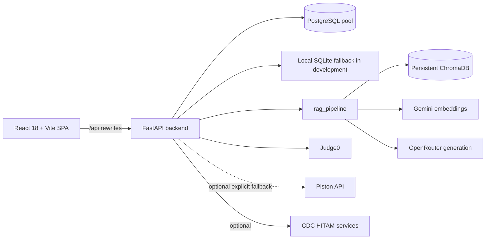

# Learniverse AI system architecture

**Reviewed:** 2026-11-08. This map reflects the source on branch `hardening/deployable-8-of-10`.

## Runtime shape

## Entry points and routing

- Frontend entry: `src/main.tsx`; route table: `src/App.tsx` (`/`, `/topics`, `/topics/:slug`, `/about`, `/how-it-works`, `/dashboard`, `/assessment`, `/top-100-codes`, `/admin/assessments`). Routes are lazy-loaded; frontend route visibility is not authorization.
- Backend entry: `backend/app.py`, ASGI object `app`, normally served by Uvicorn. `/api/*` routes are served directly and Vercel rewrites `/api/:path*` to the Render service; remaining paths use the SPA index.
- Mounted routers: `placement_assessment_system.api.router` (`/api/assessment`), `question_bank_admin.router` (`/api/admin/question-bank`), `cdc_integration.cdc_router` (`/api/cdc`), `auth_api.auth_router` (`/api/auth`), and `analytics_api.analytics_router` (`/api/analytics`).
- `auth_service.auth_router`, `institutional_api.admin_router`, `problems_dashboard_api.dashboard_router`, and `top_100_problems_api.problems_router` are not mounted by `backend/app.py`. Do not assume their routes are deployed.

## Data and request flows

- Authentication: `auth_api.py` verifies Google ID tokens against configured client IDs, checks explicit admin allowlists or exact roster email records loaded from `STUDENT_ROSTER_PATH`, and issues JWTs in `auth.py`. JWT validation is centralized there. The legacy `auth_service.py` is unmounted and uses separate in-memory account logic; it is not a production identity store.
- Database: primary PostgreSQL connection pools live in `app.py` and `placement_assessment_system/api.py`; assessment cursor dependency commits after successful endpoint return and rolls back on exceptions. Local SQLite is explicitly limited to development in the assessment path. Some analytics/report helpers and file exports use direct connections or disk backups and need consolidation.
- AI: `/api/chat` calls `rag.rag_pipeline.run_rag_pipeline`; that loads topic question prompts, retrieves Chroma chunks through `rag.retriever.retrieve_context`, embeds with Gemini, then calls the configured OpenRouter model through `rag.generator`. Retrieved metadata is returned as sources. Retrieval and provider outage paths remain dependent on external configuration and runtime data.
- Compiler: `/api/code/execute-raw`, `/api/code/run`, and `/api/code/submit` call remote execution helpers in `app.py`. Judge0 is preferred. Piston now requires `PISTON_FALLBACK_ENABLED=true`; local execution is separately gated and must stay disabled in production. Deployment sandbox limits were not exercised here.
- Assessment: `/api/assessment/start`, `/autosave`, `/resume`, `/submit`, and related routes are in `placement_assessment_system/api.py`. Candidate operations verify JWT identity and session ownership; admin endpoints require `require_admin`. Scores are calculated from saved questions server-side. Coding scores remain zero until a trusted server grader exists. Legacy scenario questions without explicit machine-scoring signals are marked for manual review and receive no automatic marks.

## Authorization summary

All assessment routes inherit `verify_api_key` (server API key or valid JWT); candidate session operations additionally require a JWT and owner check. Admin exports, monitoring and writes require an admin JWT. The question-bank router requires admin JWT at router level. CDC routes require admin JWT at router level. Analytics now requires a verified bearer JWT; the former client roll-number fallback was removed. Login, root, health/readiness, and topic catalog routes are public. Some content and code routes use the shared API/JWT guard; role-specific access is not applied unless noted above.

See `docs/audit/SECURITY_AUDIT.md` for endpoint groups and remaining authorization work.
